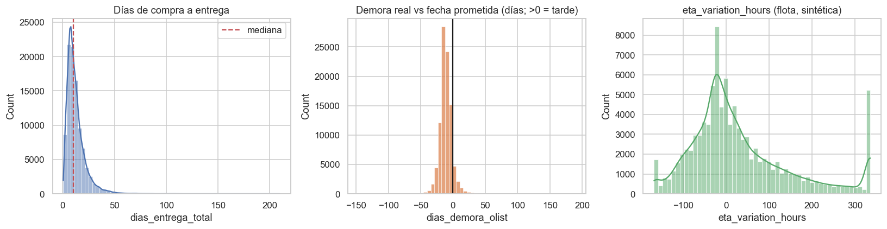
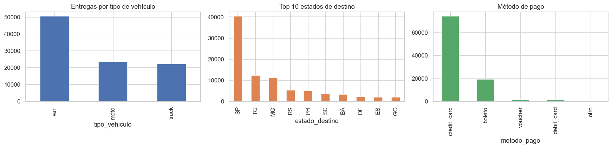
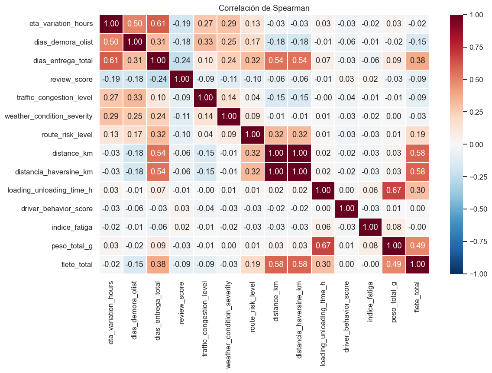
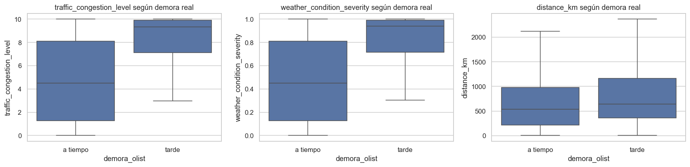
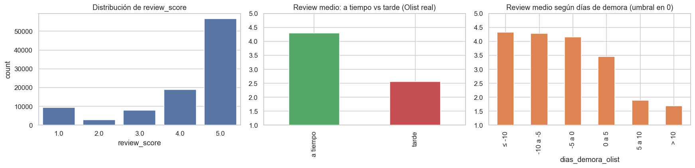
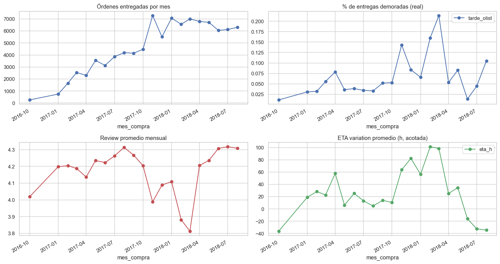
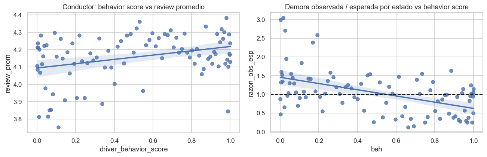

# Informe de la Etapa 2 — Preparación y análisis de los datos

**Trabajo Práctico Integrador · Análisis de Datos Masivos · Maestría en Ciencias de Datos, UCASAL 2026**
**Problema:** optimización de la cadena logística de última milla en un operador de e-commerce brasileño (Olist y flota sintética acoplada a la realidad)
**Base de datos:** `olist_logistics_db` (PostgreSQL, 14 tablas, ~1,65 millones de filas)

> Las figuras se generan con `notebooks/02_eda.ipynb` y se guardan en `../figures/`. Este archivo está pensado para abrirse desde `docs/`.

---

## 1. Resumen ejecutivo

1. **Datos preparados.** Se ejecutaron 52 chequeos de calidad (29 con hallazgos) y se construyó un **dataset analítico de 96.281 órdenes entregadas** (el 96,8 % de las órdenes), con una fila por orden y 49 variables.
2. **El problema real es la demora respecto de lo prometido.** El 8,1 % de las entregas llega tarde, y esas órdenes reciben una reseña de **2,56**, frente a **4,29** las puntuales (d de Cohen = −1,21).
3. **La demora se concentra por destino y por volumen.** BA (14,0 %) y RJ (13,5 %) duplican o más la tasa de SP (5,9 %), MG (5,6 %) y PR (5,0 %). SP y RJ explican ≈ 52 % de las órdenes tarde, y los picos de demora acompañan el volumen mensual de órdenes.
4. **Las variables operativas de la flota son simuladas.** Tráfico, clima y riesgo separan las entregas tarde (AUC univariado 0,79, 0,79 y 0,77) y el comportamiento del conductor se asocia con la demora por conductor, pero **por diseño del generador**: describen un escenario y no son evidencia empírica.
5. **La vista materializada reduce de ~0,85 s a ~5 ms la consulta filtrada** (unas 160 veces), a cambio de un refresco de ~10 s.
6. **Consecuencia para la Etapa 3:** predecir `dias_entrega_total` (regresión) y `demora_olist` (clasificación) con dos conjuntos de predictores: A (variables reales conocidas al comprar) y B (A más las simuladas). La mejora de B sobre A es por construcción.

---

## 2. Alcance y entregables

| Entregable | Archivo |
|---|---|
| Diagnóstico de calidad (52 chequeos) | `sql/01_diagnostico_calidad.sql`, `docs/diagnostico_calidad.txt`, `output/diagnostico_calidad.csv` |
| Dataset analítico (vistas SQL) | `sql/02_vistas_analiticas.sql` |
| Tablas temporales para el EDA | `sql/03_tablas_temporales.sql`, `docs/tablas_temporales.txt` |
| Análisis del plan de ejecución | `sql/04_explain_etapa2.sql`, `sql/05_refresh_y_mantenimiento.sql`, `docs/explain_etapa2.txt`, `docs/refresh_y_mantenimiento.txt`, `docs/resumen_tiempos_etapa2.csv` |
| Limpieza y exportación | `notebooks/01_limpieza.ipynb` → `output/dataset_analitico.parquet` y `.csv`, muestra de 1.000 filas, tablas auxiliares |
| Análisis exploratorio | `notebooks/02_eda.ipynb`, `figures/` |
| Informes | `docs/informe_calidad_datos.md`, `docs/conclusiones_eda.md`, este documento |
| Automatización | `sql/run_pipeline.ps1` |

---

## 3. Calidad de datos y dataset analítico

El diagnóstico encontró 29 hallazgos sobre Olist y sobre la flota; el detalle y las decisiones están en `informe_calidad_datos.md`. Los más relevantes para el análisis:

- **Duplicados 1:N:** el 9,9 % de las órdenes tiene más de un ítem, el 3,0 % más de un pago y el 0,55 % más de una reseña. Por eso el grano es **una fila por orden**, con ítems, pagos y reseñas agregados.
- **Fechas imposibles:** 166 órdenes con compra posterior al despacho y 23 con despacho posterior a la entrega; se excluyen.
- **Coordenadas:** 42 fuera de Brasil y un millón de puntos para 19.015 CEP; se reducen a un centroide por CEP.

**Embudo de filas**

| Paso | Filas | Pérdida | % sobre el total |
|---|---:|---:|---:|
| Órdenes totales | 99.441 | — | 100,00 |
| `status = delivered` | 96.478 | −2.963 | 97,02 |
| Con fecha de entrega y de despacho | 96.469 | −9 | 97,01 |
| Con fechas consistentes | 96.281 | −188 | 96,82 |
| **Dataset final** | **96.281** | 0 | **96,82** |

---

## 4. Análisis del plan de ejecución

Se compara la **vista lógica** (recalcula todos los JOIN en cada consulta) con su **copia materializada** (tabla indexada y ordenada por mes y estado). Cada escenario se ejecutó tres veces y se informa la mediana; las mediciones varían ±20 % entre corridas por la caché y la carga de la máquina.

| Escenario | Mediana (ms) | Mínimo (ms) | Plan principal |
|---|---:|---:|---|
| A. Vista lógica: agregado por estado | 391 | 371 | Cascada de Hash Join, 1 worker paralelo |
| B. Materializada: mismo agregado | 78 | 60 | Parallel Seq Scan de una tabla, 2 workers |
| C. Vista lógica: filtro (SP + mes) | 846 | 800 | Index Scan e Index Only Scan en los JOIN; agrega ítems y ordena reseñas aunque el filtro devuelve 2.898 filas |
| D. Materializada: filtro (SP + mes) | 5,4 | 5,2 | Index Scan sobre `ix_mv_ds_mes` |
| E. Construcción completa (lo que paga un refresco) | 4.297 | 4.288 | Dos *external merge sort* a disco (24,5 MB y 17,2 MB) |
| E2. `REFRESH MATERIALIZED VIEW` | 9.652 | 8.280 | Construcción, escritura e índices |

**Hallazgos**

1. **En la vista lógica, el filtro selectivo es más lento que el agregado completo** (C es más del doble de A): el costo está en las agregaciones internas (ítems y reseñas), no en los filtros. Un dashboard sobre la vista lógica pagaría casi un segundo por interacción.
2. **La materializada traslada ese costo a un único refresco.** El agregado es unas 5 veces más rápido (B frente a A) y la consulta filtrada, unas **160 veces** (D frente a C). El orden físico por mes y estado hace que el filtro lea páginas contiguas.
3. **Los índices diseñados para las consultas analíticas se usan en la vista.** El plan del escenario C usa `idx_del_analytical_base` (Index Only Scan sobre `fleet_deliveries`) e `idx_cust_id_state`, y el cálculo de `dias_desde_ult_mant` usa `idx_mnt_vehicle_date` (Index Only Scan hacia atrás, 0,002 ms por búsqueda).
4. **La construcción hace *spill* a disco** con `work_mem = 16 MB` (sorts de 24,5 MB y 17,2 MB).
5. **Impacto sobre otras operaciones.** El `REFRESH` común toma un bloqueo exclusivo y bloquea las lecturas durante unos 10 s. `REFRESH ... CONCURRENTLY` (posible gracias al índice único `ux_mv_ds_order`) no bloquea las lecturas y tardó 8,2 s con `work_mem = 64 MB`. La materializada aísla a la base operacional de las consultas analíticas, a cambio de datos tan frescos como el último refresco y 41 MB de disco.

**Espacio**

| Objeto | Total | Tabla | Índices |
|---|---:|---:|---:|
| `olist_geolocation` | 83 MB | 68 MB | 15 MB |
| `fleet_deliveries` | 80 MB | 15 MB | 65 MB (4,5 veces la tabla) |
| `olist_orders` | 59 MB | 14 MB | 45 MB (3,1 veces) |
| `olist_order_items` | 44 MB | 17 MB | 27 MB |
| `mv_dataset_analitico` | 41 MB | 34 MB | 7,6 MB |
| `mv_geo_zip` | 1,6 MB | 1,1 MB | — |

**Uso de índices.** De los 76 índices de la base, 28 no únicos nunca se usaron (≈ 71 MB; ≈ 70 MB sin los dos de la materializada). De los 14 índices adicionales de `05_indices.sql`, **5 se usan** (`idx_cust_id_state`, `idx_del_analytical_base`, `idx_rev_order_score`, `idx_mnt_vehicle_type_covering` e `idx_items_order_analytical`) y 9 no. Un índice solo vale lo que cuesta si lo usa una consulta real; los índices sin uso se conservan hasta que corran las consultas de las Etapas 3 y 4, y entonces se depuran. Los dos índices de la materializada que hoy no se usan (`ix_mv_ds_destino` e `ix_mv_ds_tipo`) probablemente los necesite el dashboard.

---

## 5. Análisis exploratorio

> **Advertencia metodológica:** las variables de Olist (fechas, reseñas, fletes, estados) son reales. En la flota, `distance_km`, `delivery_status` y `eta_variation_hours` derivan de datos reales; el resto es simulado y condicionado a la realidad. Sus asociaciones con la demora están **impuestas por diseño**.

### 5.1 Tiempos de entrega

| Variable | Media | Mediana | p95 | Máximo | Asimetría |
|---|---:|---:|---:|---:|---:|
| `dias_entrega_total` | 12,6 | 10,2 | 29,3 | 209,6 | 3,8 |
| `dias_prometidos` | 23,7 | 23,2 | 38,4 | 155,1 | — |
| `dias_demora_olist` | −11,2 | −11,9 | 3,8 | 189,0 | — |

La entrega real tiene una cola larga hacia la derecha, por lo que se usan mediana y percentiles además de la media. Olist promete plazos holgados (la demora media respecto de lo prometido es de −11 días): el problema está en la cola, donde el 8,1 % de las órdenes llega después de la fecha prometida.

### 5.2 Una sola definición de demora

`delivery_status` se deriva de la demora real de Olist y coincide con `demora_olist` en las 96.281 órdenes (88.459 a tiempo y 7.822 tarde). Por eso en todo el análisis la demora es `demora_olist`.

### 5.3 Segmentación

**Por tipo de vehículo.** El tipo se asigna por el peso del producto, por lo que la diferencia de demora no es causal. Tráfico, clima y riesgo no dependen del tipo.

| Tipo | Entregas | Demora real | Días de entrega (mediana) | Reseña | Tráfico | Clima | Riesgo |
|---|---:|---:|---:|---:|---:|---:|---:|
| moto | 23.526 | 7,4 % | 9,4 | 4,15 | 5,00 | 0,495 | 6,89 |
| van | 50.539 | 8,1 % | 10,2 | 4,17 | 4,99 | 0,497 | 7,04 |
| truck | 22.216 | 8,9 % | 11,1 | 4,12 | 4,99 | 0,503 | 7,04 |

V de Cramér = 0,019 (el valor p de 1e-8 se debe solo al tamaño de la muestra).

**Por estado de destino** (los ocho de mayor volumen):

| Estado | Órdenes | Demora real | Días de entrega (mediana) | Reseña | Flete mediano (BRL) |
|---|---:|---:|---:|---:|---:|
| BA | 3.252 | **14,0 %** | 16,9 | 3,93 | 22,1 |
| RJ | 12.330 | **13,5 %** | 12,0 | 3,97 | 18,0 |
| SC | 3.534 | 9,8 % | 13,1 | 4,13 | 18,2 |
| RS | 5.327 | 7,2 % | 13,2 | 4,19 | 18,2 |
| DF | 2.077 | 7,1 % | 11,4 | 4,13 | 18,1 |
| SP | 40.427 | 5,9 % | 7,2 | 4,25 | 13,6 |
| MG | 11.327 | 5,6 % | 10,3 | 4,19 | 18,2 |
| PR | 4.912 | 5,0 % | 10,4 | 4,24 | 17,9 |

SP y RJ explican ≈ 52 % de todas las órdenes tarde (≈ 2.385 y ≈ 1.665 de 7.822): SP por volumen, con tasa baja, y **RJ por combinar volumen y tasa altos**, lo que lo vuelve el destino prioritario. BA tiene la peor tasa y la peor reseña, con poco volumen.

### 5.4 Factores frente a la demora real

| Factor | Origen | rho vs días de demora | d de Cohen | AUC univariado |
|---|---|---:|---:|---:|
| `traffic_congestion_level` | simulado | +0,327 | 1,10 | 0,789 |
| `weather_condition_severity` | simulado | +0,252 | 1,08 | 0,788 |
| `route_risk_level` | simulado | +0,174 | 0,89 | 0,773 |
| `driver_behavior_score` | simulado | −0,058 | −0,36 | 0,400 |
| `indice_fatiga` | simulado | −0,014 | −0,28 | 0,420 |
| `loading_unloading_time_h` | simulado (control) | −0,006 | 0,05 | 0,514 |
| `distancia_haversine_km` | **real** | **−0,179** | 0,24 | 0,563 |
| `distance_km` | derivada de datos reales | −0,178 | 0,24 | 0,563 |
| `flete_total` | **real** | **−0,155** | 0,09 | 0,547 |
| `peso_total_g` | real | −0,017 | 0,06 | 0,515 |

Las variables simuladas con vínculo (tráfico, clima y riesgo) separan las entregas tarde por diseño; el tiempo de carga y descarga no tiene vínculo y sirve de control. Entre las **variables reales**, la distancia y el flete se asocian **negativamente** con los días de demora: Olist promete plazos más largos para destinos lejanos, de modo que la demora respecto de lo prometido baja cuando la distancia sube.

### 5.5 Demora y satisfacción

| | Reseña si tarde | Reseña si a tiempo | d de Cohen |
|---|---:|---:|---:|
| **Demora real (Olist)** | **2,56** | **4,29** | **−1,21** (efecto muy grande) |

La correlación de Spearman entre días de demora y reseña es solo −0,177 porque la relación es un **umbral**: llegar antes de lo prometido no cambia la reseña; el efecto aparece al pasar la fecha prometida. Por eso la variable adecuada es la binaria `demora_olist`. Hay reseña en el 99,3 % de las órdenes.

### 5.6 Temporalidad

La serie año-mes muestra picos de demora real en **noviembre de 2017 (14,3 %)**, **febrero de 2018 (16,0 %)** y **marzo de 2018 (21,4 %)**. La demora real acompaña el volumen mensual de órdenes (rho = +0,68; 21 meses), lo que sugiere **saturación de capacidad** (hipótesis a validar, no probada). Agrupar por mes calendario mezcla años (septiembre a diciembre existen solo en 2016 y 2017, y enero a agosto en 2017 y 2018): el 17,2 % de marzo refleja sobre todo marzo de 2018.

Mantenimiento e incidentes frente a la demora mensual (21 meses, orientativo):

| Variable | rho (valor absoluto) | rho (por cada 1.000 entregas) |
|---|---:|---:|
| Mantenimientos correctivos | +0,58 | **−0,09** |
| Incidentes | +0,71 | +0,70 |
| Costo de mantenimiento | +0,66 | — |
| Entregas (volumen) | +0,68 | — |

Los correctivos acompañan a la demora solo a través del **volumen**: al normalizar, la asociación desaparece. Los incidentes siguen asociados porque su probabilidad incluye la demora real **por construcción**.

### 5.7 Conductores

Los 95 conductores (uno por vehículo activo) tienen entre 498 y 2.166 entregas (mediana 976).

| Perfil (behavior score) | Conductores | Entregas | Demora real | Reseña |
|---|---:|---:|---:|---:|
| Alto | 35 | 35.583 | 6,1 % | 4,19 |
| Medio | 19 | 20.116 | 5,5 % | 4,23 |
| Bajo | 41 | 40.582 | 11,4 % | 4,10 |

Por conductor, el score se asocia con la tasa de demora (rho = −0,43; p = 1,2e-5) y con la reseña (rho = +0,25; p = 0,015). **Ajustado por estado de destino** (razón entre la demora observada y la esperada según la mezcla de estados de cada conductor) el efecto se mantiene: score −0,47 (p = 1,9e-6) y fatiga +0,54 (p = 2e-8). Por entrega el efecto es débil (rho = −0,058). En el simulador, el score y la fatiga sesgan la asignación de entregas tardías: es un efecto **por diseño**. Los perfiles medio y alto no se ordenan porque, con pocos conductores por perfil, pesan el ruido y el estado de operación.

---

## 6. Consecuencias para la Etapa 3

| Decisión | Fundamento |
|---|---|
| **Clasificación:** objetivo `demora_olist` (8,1 % de positivos, clase desbalanceada: AUC-PR y recall) | Tiene efecto real sobre la reseña |
| **Regresión:** objetivo `dias_entrega_total` | `eta_variation_hours` está censurada (6,4 %) y deriva de las fechas reales |
| **Conjunto A de predictores:** variables reales conocidas al comprar: estados de origen y destino, distancia haversine, flete, peso, categoría, mes, volumen mensual y días prometidos | Son las únicas con señal empírica |
| **Conjunto B = A + variables simuladas:** tráfico, clima, riesgo, conductor y `dias_desde_ult_mant` | La mejora de B sobre A es **por construcción**: se reporta como cota superior del escenario simulado, no como poder predictivo |
| **Validación temporal** (entrenamiento hasta 2018-04, prueba desde 2018-05) | Evita mezclar futuro y pasado |
| **Excluir como predictores:** `dias_entrega_total`, `dias_hasta_despacho`, `dias_transito`, `dias_demora_olist`, `eta_variation_hours`, `delivery_status`, `review_score`, `resena_negativa`, `n_incidentes`, `horas_impacto_incidentes` | Fuga de información: se conocen después de la entrega o son el objetivo |
| **Nulos:** `dias_desde_ult_mant` (2,2 %) y `distancia_haversine_km` (0,5 %) | Imputar con un indicador, o usar un modelo que admita nulos |
| **Dashboard:** segmentar por destino y mes y normalizar los conteos por volumen | RJ y BA concentran la demora; los conteos absolutos engañan |

---

## 7. Limitaciones

- Las variables de flota son **simuladas y condicionadas a la realidad**: sus asociaciones con la demora son propiedades del simulador. Los indicadores basados en ellas describen el sistema simulado.
- Tráfico, clima y riesgo se generan condicionados al resultado: usarlos como predictores equivale a una fuga de información y produce AUC altos por construcción.
- La hipótesis de saturación de capacidad se apoya en 21 meses y no está probada; los análisis mensuales son orientativos.
- Los datos reales cubren 2016-09 a 2018-08, con picos de demora en noviembre de 2017 y en febrero y marzo de 2018 que afectarán la validación temporal.
- No se midió si `work_mem = 64 MB` elimina el *spill* de la construcción del dataset; para verificarlo, ejecutar `SET work_mem = '64MB'; EXPLAIN (ANALYZE) SELECT * FROM vw_dataset_analitico;` y buscar líneas `Disk:`.
